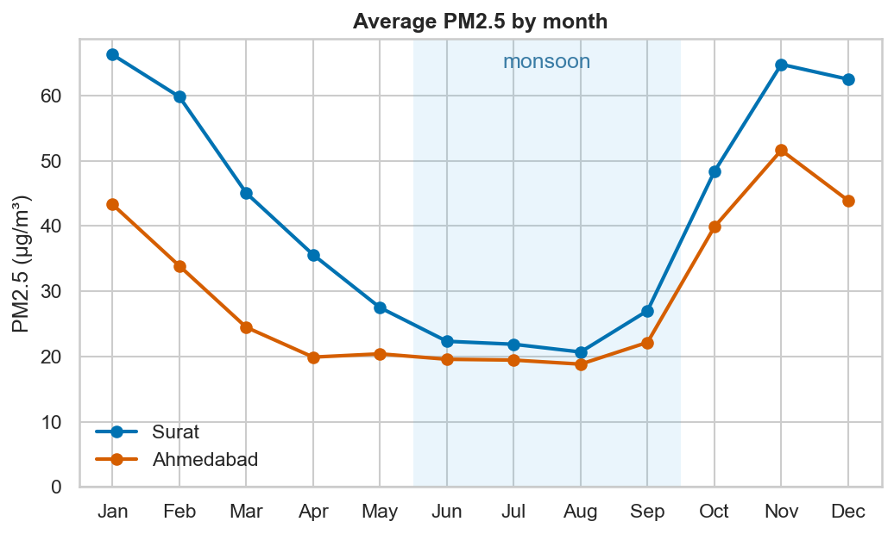
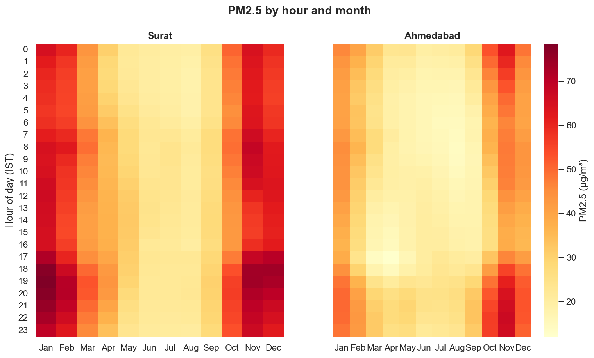
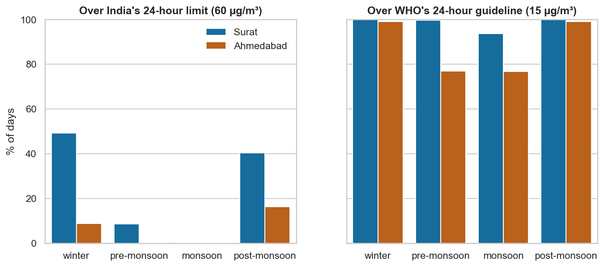
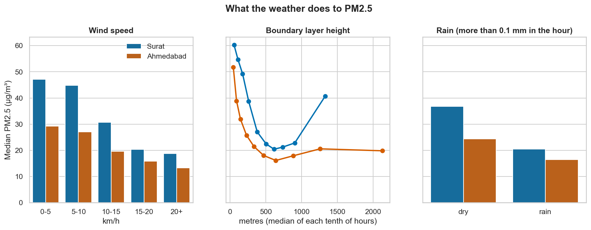
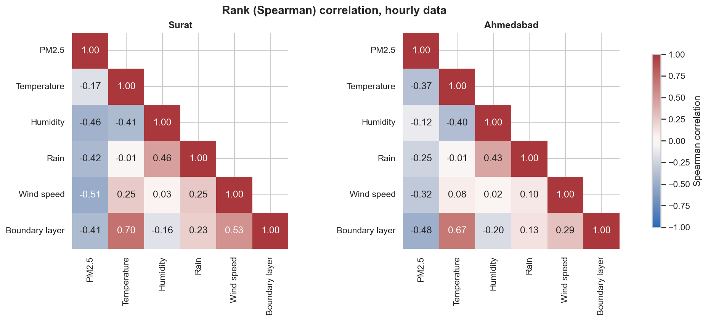
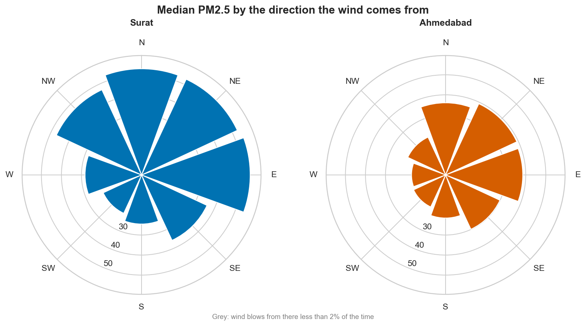
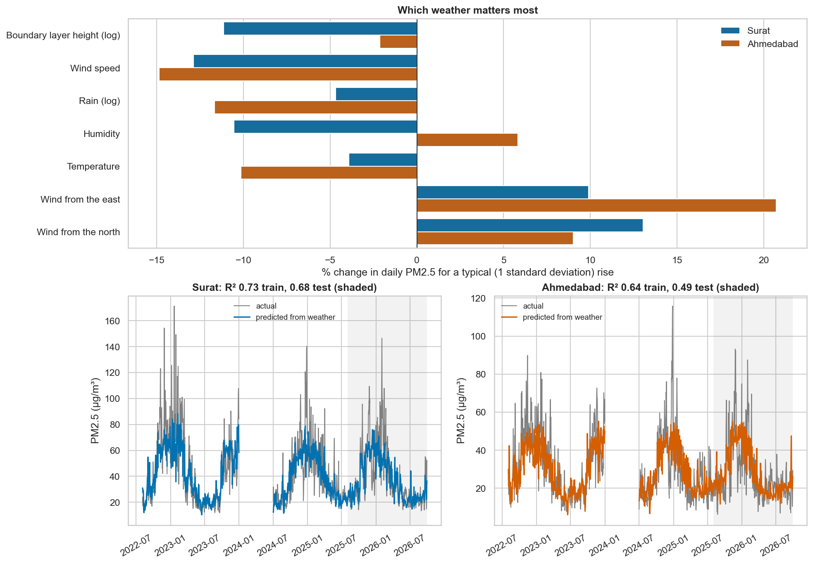
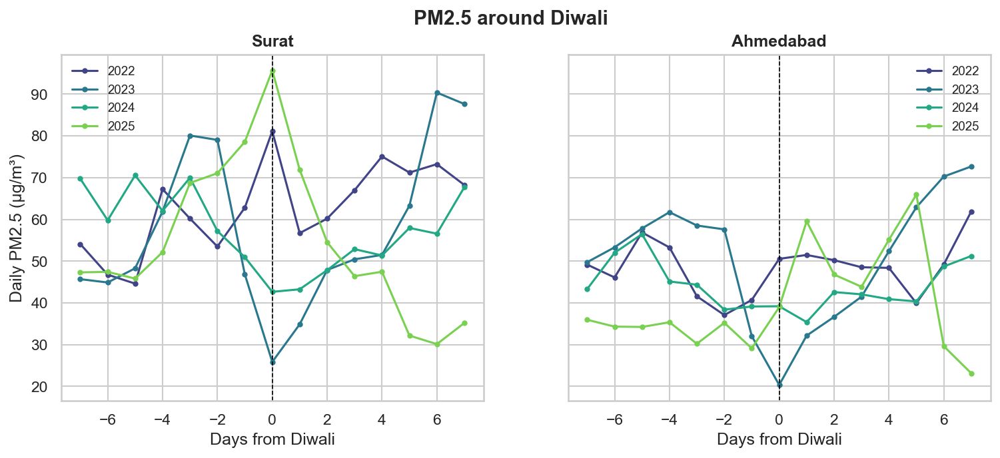

# Why is Surat's air worse in winter?

Surat's air in January is about three times dirtier than in August. I wanted to know how much of that is the weather, and whether being near the sea helps. This project pulls four years of hourly air quality and weather data for Surat and, for comparison, inland Ahmedabad, and works through it with pandas, numpy, matplotlib and seaborn.



## Findings

1. **Winter is 2.7× worse than the monsoon in Surat.** Daily PM2.5 averages 63 µg/m³ in January–February and 23 µg/m³ in June–September. Half of all winter days (49%) are over India's 24-hour limit of 60 µg/m³, and in every season more than 90% of days are over the WHO guideline of 15.
2. **Weather explains most of the winter jump.** A regression on daily weather alone, trained on Aug 2022 to Jul 2025, predicts 35 of the 42 µg/m³ gap between winter and monsoon in Surat over all days. On the 14 months it never saw (Aug 2025 to Sep 2026) it predicts 28 of 42, with an R² of 0.68. In Ahmedabad it predicts the whole 19 µg/m³ gap on both, with a test R² of 0.49.
3. **Wind from the southwest and west is cleaner than wind from the north and east, even within the same season.** After Surat's monsoon (Oct–Dec), PM2.5 is 39 µg/m³ with a southwest or west wind and 55 with a north, northeast or east wind. Ahmedabad shows the same in every season. Winter is the one exception in Surat. Being on the coast does not make Surat cleaner overall though: in this data Surat is worse than Ahmedabad in every month.
4. **Diwali does not show up reliably.** Diwali-day PM2.5, compared with the median of 3 to 7 days before, ranges from a third to double depending on the year and city. The data comes from a model that works from regular emission inventories, which are unlikely to include one night of firecrackers. This needs ground sensors.

## Data

Everything comes from [Open-Meteo](https://open-meteo.com/), which needs no API key.

| | Source | Variables (hourly) |
|---|---|---|
| Air quality | [Air Quality API](https://open-meteo.com/en/docs/air-quality-api) (CAMS global model) | PM2.5, PM10, NO₂ |
| Weather | [Historical Weather API](https://open-meteo.com/en/docs/historical-weather-api) (reanalysis, default model) | temperature, humidity, rain, wind speed and direction, boundary layer height |

- Period: 1 Aug 2022 (when the global air quality model's history starts) to 29 Sep 2026. 36,504 hours per city.
- Locations: Surat (21.17° N, 72.83° E) and Ahmedabad (23.03° N, 72.58° E). Times are IST.
- A snapshot of the raw downloads is in `data/raw/` (1.3 MB gzipped CSV), so every chart can be rebuilt offline.

**Boundary layer height** is how high the air near the ground mixes before it hits a stable layer above. A low boundary layer squeezes the same pollution into less air.

### Cleaning

- Air and weather are joined hour by hour. An hour the API skipped becomes an explicit gap instead of disappearing.
- Gaps of up to 3 hours are filled linearly; longer gaps stay empty.
- A daily value counts only if the day has at least 16 valid hours, the same rule CPCB uses for 24-hour averages. Days without 16 hours of PM2.5 are dropped.
- Checks: no negative values and no hours with PM2.5 above PM10 (impossible, since PM2.5 is part of PM10). The PM2.5 series starts 77 hours after 1 Aug 2022, so the first three days are dropped.
- **Model outage:** from 13 Dec 2022 17:00 to 16 Dec 2022 04:00 (60 hours, same hours in both cities) NO₂ is exactly zero and PM2.5 is around 1 µg/m³. Real city air always has some NO₂, so any run of 6 or more hours with NO₂ at exactly zero is treated as a model outage and the air values are removed. That drops two more days.
- **Weather gap:** boundary layer height is missing from 1 Jan to 30 Jun 2024 (182 days) in both cities. I checked the other models the archive offers (ERA5, ERA5 seamless, ECMWF IFS) and all have the same hole, so those days are left out of anything that uses boundary layer height. Nothing is invented to fill it.
- Seasons follow IMD: winter Jan–Feb, pre-monsoon Mar–May, monsoon Jun–Sep, post-monsoon Oct–Dec.

## When is the air bad?



The worst hours are evenings from October to February: 5–10 pm from November to January in Surat, and 7 pm to 2 am in November in Ahmedabad. That is when the ground cools after sunset and the boundary layer drops. Monsoon months stay low around the clock.



| % of days over India's 60 µg/m³ limit | Winter | Pre-monsoon | Monsoon | Post-monsoon |
|---|---|---|---|---|
| Surat | 49% | 9% | 0% | 40% |
| Ahmedabad | 9% | 0% | 0% | 16% |

## Why winter?



Looking at one weather variable at a time (median PM2.5 over all hours):

- **Wind speed:** calm hours (under 5 km/h) have 47 µg/m³ in Surat; windy hours (20 km/h or more) have 19.
- **Boundary layer:** the lowest tenth of hours (around 55 m) has 60 µg/m³ in Surat; the middle of the range drops to about 20.
- **Rain:** rainy hours have 20 µg/m³ in Surat against 37 in dry hours.

The boundary layer line turns back up for Surat's highest tenth. Those hours are mostly hot, dry afternoons outside the monsoon, when the air is dirtier anyway. Looking at one variable at a time mixes up effects like this, which is why the regression below looks at all the weather together.



The weather variables are also related to each other: boundary layer height and temperature have a correlation of 0.70 in Surat, because warm afternoons lift the boundary layer. Keep that in mind when reading the regression.

## Does the coast help?



Wind direction is grouped into eight compass sectors (`((degrees + 22.5) // 45) % 8`, so north covers 337.5° to 22.5°). The direction is where the wind comes from.

| Median PM2.5 (µg/m³) | N | NE | E | SE | S | SW | W | NW |
|---|---|---|---|---|---|---|---|---|
| Surat | 53 | 53 | 54 | 36 | 24 | 21 | 28 | 47 |
| Ahmedabad | 36 | 39 | 38 | 30 | 22 | 18 | 17 | 21 |

The southwest is Surat's most common wind direction (a third of all hours) and the cleanest. But wind direction changes with the season: southwesterly in the monsoon, northeasterly after it. So the table above partly shows the season, not the wind. Comparing within each season:

| Median PM2.5 (µg/m³), SW/W wind vs N/NE/E wind | Winter | Pre-monsoon | Monsoon | Post-monsoon |
|---|---|---|---|---|
| Surat | 63 vs 56 | 28 vs 39 | 20 vs 37 | 39 vs 55 |
| Ahmedabad | 24 vs 38 | 16 vs 23 | 17 vs 24 | 33 vs 42 |

The southwest/west wind is cleaner in every season except Surat's winter, where it blows only 638 hours out of about 5,700, too few to read much into.

## How much does the weather explain?



For each city I fit an ordinary least squares regression of daily log(PM2.5) on the weather, using `numpy.linalg.lstsq`:

- Features: log(boundary layer height), wind speed, log(1 + rain), humidity, temperature, and wind direction as sin and cos. A daily wind direction is a vector mean (average the sin and cos of each hour, then `arctan2`), because the plain average of 350° and 10° is 180°, which points the wrong way.
- PM2.5 is log-transformed because it is skewed and weather tends to change it by a percentage, not a fixed amount.
- Features are converted to z-scores (with the training period's mean and standard deviation) so their effects can be compared. This doesn't change the predictions. The chart shows the % change in PM2.5 for a typical (1 standard deviation) rise in each one.
- Train on Aug 2022 to Jul 2025 (909 days), test on Aug 2025 to Sep 2026 (425 days). Days in the boundary layer gap and the model outage are left out.

| | R² train | R² test | Winter minus monsoon, actual | Predicted, all days | Test period: actual | Test period: predicted |
|---|---|---|---|---|---|---|
| Surat | 0.73 | 0.68 | 42 µg/m³ | 35 | 42 | 28 |
| Ahmedabad | 0.64 | 0.49 | 19 µg/m³ | 19 | 19 | 20 |

(The winter and monsoon figures here are geometric means, since the model works in logs, so they differ a little from the plain averages above.)

Wind speed has the steadiest effect: a typical rise cuts PM2.5 by 13% in Surat and 15% in Ahmedabad. Wind from the north and east raises it in both cities. The individual effects of boundary layer height, temperature and humidity should be read loosely. Those three move together, so the regression can shift credit between them; in Ahmedabad, temperature seems to take most of what boundary layer height shows on its own. That may also be why humidity has opposite signs in the two cities.

## Diwali



| Diwali-day PM2.5 ÷ median of days −7 to −3 | 2022 | 2023 | 2024 | 2025 |
|---|---|---|---|---|
| Surat | 1.50 | 0.54 | 0.61 | 2.02 |
| Ahmedabad | 1.03 | 0.35 | 0.87 | 1.14 |

No consistent jump. Whatever the data shows around Diwali is the weather and the model's regular emissions.

## Caveats

- **This is model data, not sensor readings.** Open-Meteo's air quality comes from the CAMS global model, which works on a grid roughly 40 km across. Its emission estimates and coarse grid decide things like Surat being worse than Ahmedabad; CPCB ground stations may disagree.
- Because CAMS is itself driven by weather, the regression partly measures how the model behaves. With sensor data the weather would likely explain less.
- The weather features are correlated with each other, so the size of each one's effect is less certain than the overall fit.
- Hourly data is autocorrelated (one hour looks like the next), so the hourly medians and correlations describe the data rather than test anything.

## Run it

Needs Python 3.10+.

```bash
python -m venv .venv
source .venv/bin/activate
pip install -e '.[dev]'

python -m airq report   # rebuild every chart from data/raw
python -m airq fetch    # download a fresh snapshot (up to 7 days ago)
pytest                  # 75 tests, no network needed
```

`report` also prints the numbers behind the findings and tables above.

## Layout

```
src/airq/
  cities.py   city coordinates, Diwali dates, API variable names
  fetch.py    Open-Meteo downloads: retries with backoff on 5xx/timeouts, atomic writes
  clean.py    join, outage and gap handling, sanity checks, daily averages, seasons
  analyze.py  all the numbers (pure functions, no plotting or file access)
  report.py   runs the analysis once and prints the summary
  plots.py    matplotlib/seaborn charts for this README
  cli.py      python -m airq fetch | report
tests/        pytest, with the network mocked out
```
